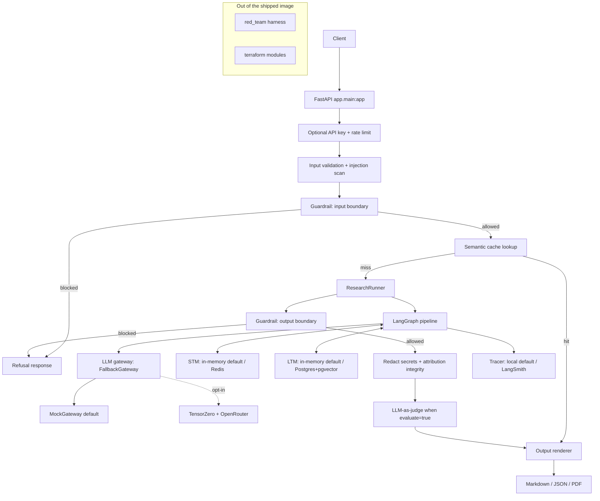
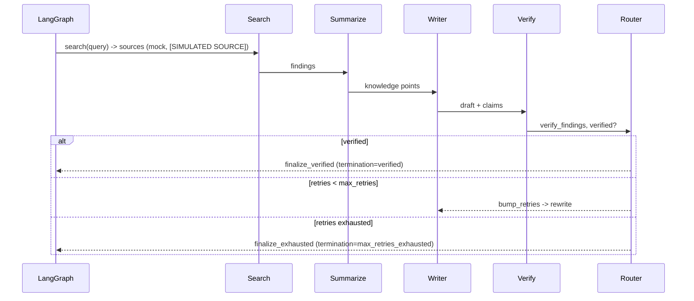

<div align="center">

# 🔎 Queryn

### Offline-First Multi-Agent AI Research Platform

A FastAPI service over a four-agent LangGraph pipeline (Search → Summarize → Writer → Verify) that turns a research topic into a verified, source-attributed report. Every default code path runs offline with mock providers: no API keys, no network calls, and zero external-service cost.


-7B42BC?logo=terraform&logoColor=white)

</div>

---

## Overview

Queryn researches a topic through four specialized agents coordinated as a stateful LangGraph graph, then returns a report with explicit source attribution, bounded retries, and a deterministic termination outcome. It is **offline-first**: the default build uses a deterministic mock Search provider and a mock LLM gateway, in-process substitutes for Redis, PostgreSQL+pgvector, Bedrock Guardrails, and LangSmith, and makes no network calls and requires no credentials.

External integrations (TensorZero + OpenRouter, Redis, Postgres, AWS Bedrock Guardrails, LangSmith, PyRIT) sit behind narrow interfaces whose concrete implementation is selected from environment configuration at startup. When nothing is configured, the local substitute is chosen. The OpenRouter path is strictly opt-in and **requires an explicit model id** — no model is ever assumed or hard-coded, and no model is assumed to be free.

Synthetic search results are always labeled `[SIMULATED SOURCE]` with `mock://` URIs and are never presented as real research.

## Highlights

- Four-agent pipeline with a verification/revision loop and bounded, deterministic termination.
- A single LLM gateway abstraction with an ordered fallback chain; mock is the default, OpenRouter via TensorZero is opt-in.
- Short-term memory, long-term vector memory, and an embedding-similarity semantic cache, each with an in-process offline default.
- Input/output validation, prompt-injection neutralization, and guardrails applied at both trust boundaries.
- Deterministic offline LLM-as-judge scoring and an in-memory tracer.
- Markdown, JSON, and PDF output renderers.
- An offline adversarial red-team suite covering jailbreak, XPIA, crescendo, and skeleton-key families.
- Comment-free Dockerfile, GitHub Actions CI, and Terraform modules (written, not applied).

## Technology Stack

| Category | Technology | Notes |
|---|---|---|
| Language | Python 3.11+ | `requires-python >=3.11`, `.python-version` pinned to 3.11 |
| Packaging | uv | manages the project and `uv.lock`; optional extras isolate heavy deps |
| API | FastAPI + Uvicorn | ASGI app importable as `app.main:app` |
| Validation | Pydantic v2 + pydantic-settings | request/response schemas and settings |
| Orchestration | LangGraph | `StateGraph` over a `ResearchState` TypedDict |
| Numerics | NumPy | offline hashed-token embeddings |
| LLM gateway (opt-in) | TensorZero → OpenRouter | optional `openrouter` extra; mock default |
| Short-term memory (opt-in) | Redis | optional `redis` extra; in-memory default |
| Long-term memory (opt-in) | PostgreSQL + pgvector | optional `postgres` extra; in-memory default |
| Guardrails (opt-in) | AWS Bedrock Guardrails | optional `bedrock` extra; local guardrail default |
| Tracing/eval (opt-in) | LangSmith | local tracer default |
| PDF output | fpdf2 | optional `pdf` extra, pure-Python, offline |
| Red team (opt-in) | PyRIT | optional `redteam` extra; local harness is the active path (see below) |
| Tooling | Ruff, mypy, pytest, pytest-asyncio, httpx | dev dependency group |
| Container | Docker | multi-stage build with uv |
| IaC | Terraform | written, not applied (see Deployment) |
| CI | GitHub Actions | lint/type/test/build; gated deploy job |

Exact pinned versions live in `pyproject.toml` and `uv.lock`.

## Architecture



The `/research` route enforces a fixed order: optional auth and rate limit, body validation, PDF availability check, injection scan, input guardrail, cache lookup, pipeline run, **output guardrail before attribution-integrity validation**, secret redaction, output validation, optional judge scoring, then rendering.

## Research Workflow



The graph nodes are `search → summarize → writer → verify`, with a conditional router after `verify`. The router (`route_after_verify`) is a pure function that chooses `finalize_verified`, `finalize_exhausted`, or `bump_retries`; the `bump_retries` node is the sole writer of the retry counter. The runner seeds the initial state `{query, mode, retries: 0, max_retries, verified: False}` and sets a `recursion_limit = 5 + 3 * max_retries + 2` backstop, catching `GraphRecursionError` as `termination="failed"`. Claim support uses a shared token-containment metric (threshold 0.5) that also drives the judge scores.

## Agents

- **Search** calls `SearchProvider.search(query)`. The default provider returns deterministic synthetic sources seeded by a hash of the query, each `mock=True` with a `mock://` URI and `[SIMULATED SOURCE]` title/snippet. At least one source is always produced.
- **Summarize** condenses findings into knowledge points via the injected LLM gateway.
- **Writer** drafts the report and emits claims. The mock writer copies source-snippet tokens into claims so the normal path verifies on the first pass.
- **Verify** checks each claim's `source_ids` exist and clear the containment threshold, sets `verified`, and never touches the retry counter.

Agents only receive model text through the injected `LLMGateway`; they never call a provider SDK directly.

## Memory and Caching

- **Short-term memory** stores per-session context. Default is in-memory; `REDIS_URL` selects the Redis adapter.
- **Long-term memory** stores embeddings for semantic retrieval. Default is in-memory; `DATABASE_URL` selects the Postgres + pgvector adapter.
- **Semantic cache** keys results by an offline hashed-token embedding (256-dim, L2-normalized) and returns a cached `ResearchResult` when cosine similarity meets `QUERYN_CACHE_SIMILARITY_THRESHOLD` (default `0.95`). It uses a store separate from LTM and shares only the embedding function. Because the embedding is a hashed bag-of-tokens projection, a near-duplicate that normalizes to the same tokens (case/whitespace variants) is a reliable cache hit, while a changed content token can drop similarity below the threshold. Cache provenance is surfaced only through the `cache_hit` field.

## Security

- **Input validation** rejects empty/oversized topics and invalid fields with HTTP 422.
- **Injection defense** neutralizes matched spans and wraps untrusted blobs before they reach the graph, recording an event in the trace.
- **Guardrails** run at both trust boundaries. `LocalGuardrail` (default) enforces a documented local policy and blocks the labeled-unsafe set. `BedrockGuardrail` is used only when `QUERYN_GUARDRAIL=bedrock` with a guardrail id and region configured; its adapter is import-guarded and falls back to the local guardrail on error. A blocked input or output returns a safe refusal.
- **Output handling** redacts configured secret values and `sk-`-shaped tokens with `[REDACTED]`, then enforces attribution integrity (every cited `source_id` must exist in the produced sources). An integrity breach returns HTTP 500 with a generic message. On the default offline path no secret value exists and the mock LLM never emits secret-shaped tokens, so redaction is a no-op.
- **Auth** is an optional `X-API-Key` dependency, enforced only when `QUERYN_API_KEY` is set; the offline default is keyless. A mismatch returns HTTP 401.
- **Rate limiting** is an in-memory token bucket per client key/IP with a configurable rate; exhaustion returns HTTP 429.

> Guardrails reduce risk but do not guarantee every attack is blocked. Defense in depth, least privilege, adversarial evaluation, and monitoring remain necessary.

### Red Team

The adversarial suite covers four families as data (prompts, config under test, expected outcome): **jailbreak**, **XPIA**, **crescendo** (multi-turn), and **skeleton key**. Each scenario is run against the `LocalGuardrail` + `MockGateway`, recording the config, observed response, and pass/fail per scenario.

**Active red-team path: the labeled local adversarial harness (NOT PyRIT).** During the build, `uv sync --extra redteam` resolved `pyrit==0.8.1` but could not install cleanly offline on Python 3.11, because PyRIT's Jupyter dependency chain (`jupyter` → `jupyterlab`) was not available in the offline cache. The active runner is therefore `red_team/harness.py`, explicitly labeled `LOCAL ADVERSARIAL HARNESS - NOT PyRIT`; it is a substitute for PyRIT and is never claimed to be PyRIT. `red_team/pyrit_runner.py` remains import-guarded (`pyrit_available()` returns `False` offline) and its live path is skipped. The PyRIT path would activate only in an environment where `uv sync --extra redteam` succeeds with the full Jupyter dependency chain available. The suite runs offline at zero cost either way.

## Evaluation and Observability

- **Tracing** records agent order, provider/mode per call, retry/fallback events, and the terminal outcome, with secret redaction. `LocalTracer` (default) keeps an in-memory run trace and emits structured logs; `NoopTracer` disables it (`QUERYN_TRACING=noop`); `LangSmithTracer` is used only when LangSmith env is configured.
- **LLM-as-judge** scores relevance, faithfulness, groundedness, completeness, and coherence in `[0, 1]` using the shared containment metric. Offline these scores are deterministic. They are signals, not proof of correctness, and are returned only when a request sets `evaluate: true`.

## Project Structure

```text
queryn/
├── app/
│   ├── api/            routes, schemas, auth, rate_limit
│   ├── agents/         search, summarize, writer, verify
│   ├── graph/          state, build, runner
│   ├── gateway/        base, mock, tensorzero_gw, fallback, factory
│   ├── search/         base, mock
│   ├── memory/         embeddings, stm_*, ltm_*, cache, factory
│   ├── security/       validation, injection, guardrail_*, factory
│   ├── eval/           tracing_*, judge, factory
│   ├── output/         markdown, json_out, pdf, factory
│   ├── observability/  logging
│   ├── config.py       settings + startup mode resolution
│   └── main.py         create_app() + app.main:app
├── red_team/           scenarios, harness, pyrit_runner (repo root)
├── terraform/          modules/{network,ecs,data,security} (written, not applied)
├── tests/              unit, integration, security, eval
├── .github/workflows/  ci.yml
├── Dockerfile
├── .dockerignore
├── pyproject.toml
├── uv.lock
├── .python-version
├── .env.example
├── LICENSE
└── README.md
```

## Prerequisites

- Python 3.11 (uv can install it for you).
- [uv](https://docs.astral.sh/uv/) 0.11.2 or compatible.
- Docker (optional, for the container build).

## Installation

```bash
uv sync --extra pdf
```

`uv sync` creates the virtual environment, installs locked dependencies, and installs the project. The `pdf` extra enables PDF output via fpdf2. Add `--extra redteam` only if you want to attempt the PyRIT path in an environment that can install its dependency chain.

## Configuration

Copy `.env.example` to `.env` and set only what you need. Every variable has a safe offline default; leaving them unset keeps Queryn fully offline.

| Variable | Default | Purpose |
|---|---|---|
| `QUERYN_LLM_PROVIDER` | `mock` | Set to `openrouter` to opt in to the live LLM path. |
| `QUERYN_OPENROUTER_MODEL` | *(empty)* | Required non-empty model id when the provider is `openrouter`; no model is assumed. |
| `OPENROUTER_API_KEY` | *(empty)* | OpenRouter credential; without it the provider resolves back to mock. |
| `QUERYN_GUARDRAIL` | `local` | Set to `bedrock` to use AWS Bedrock Guardrails when configured. |
| `QUERYN_TRACING` | `local` | `local`, `noop`, or `langsmith` (LangSmith needs its env set). |
| `QUERYN_MAX_VERIFY_RETRIES` | `2` | Maximum Writer→Verify revisions before exhaustion. |
| `QUERYN_CACHE_SIMILARITY_THRESHOLD` | `0.95` | Cosine threshold for a semantic cache hit. |
| `QUERYN_API_KEY` | *(empty)* | When set, `/research` requires a matching `X-API-Key` header. |
| `QUERYN_RATE_LIMIT_PER_MINUTE` | `60` | Per-client token-bucket rate. |
| `REDIS_URL` | *(empty)* | Selects the Redis STM adapter when set. |
| `DATABASE_URL` | *(empty)* | Selects the Postgres + pgvector LTM adapter when set. |
| `LANGCHAIN_TRACING_V2` | *(empty)* | Set with `LANGCHAIN_API_KEY` to enable LangSmith tracing. |
| `LANGCHAIN_API_KEY` | *(empty)* | LangSmith credential. |
| `LANGCHAIN_PROJECT` | *(empty)* | LangSmith project name. |
| `AWS_REGION` | *(empty)* | Region for the Bedrock Guardrails call. |
| `AWS_ACCESS_KEY_ID` | *(empty)* | AWS credential (never commit a real value). |
| `AWS_SECRET_ACCESS_KEY` | *(empty)* | AWS credential (never commit a real value). |
| `AWS_BEDROCK_GUARDRAIL_ID` | *(empty)* | Guardrail identifier for the Bedrock adapter. |
| `AWS_BEDROCK_GUARDRAIL_VERSION` | *(empty)* | Guardrail version. |

`.env.example` contains placeholders only. Never commit real credentials; in production, retrieve secrets through AWS Secrets Manager or an equivalent.

## Running the Service

```bash
uv run uvicorn app.main:app --host 0.0.0.0 --port 8000
```

### Endpoints

`GET /health` returns the resolved mode map (no auth):

```bash
curl http://localhost:8000/health
```

```json
{
  "status": "ok",
  "modes": {
    "llm": "mock",
    "stm": "memory",
    "ltm": "memory",
    "guardrail": "local",
    "tracing": "local",
    "pdf_enabled": true
  }
}
```

`POST /research` runs the pipeline. The body accepts `topic` (required), optional `session_id`, `output_format` (`markdown` default, `json`, or `pdf`), and `evaluate` (default `false`):

```bash
curl -X POST http://localhost:8000/research \
  -H "Content-Type: application/json" \
  -d '{"topic": "sustainable urban transport", "output_format": "markdown"}'
```

The response is a `ResearchResult` with `report`, `output_format`, `sources`, `claims`, `mode`, `termination` (`verified`, `max_retries_exhausted`, or `failed`), `cache_hit`, and `scores`. For `output_format: markdown` the `report` field holds rendered Markdown with an attributions section and a simulated-sources banner; `json` returns the full result; `pdf` returns `application/pdf` bytes (and returns HTTP 415 when PDF is disabled). When `QUERYN_API_KEY` is set, add `-H "X-API-Key: <key>"`.

## Testing

Run the full gate from the repository root (PowerShell uses `;` to separate commands, not `&&`):

```bash
uv run ruff check .
uv run ruff format --check .
uv run mypy .
uv run pytest
docker build -t queryn .
```

Tests live under `tests/unit`, `tests/integration`, `tests/security`, and `tests/eval`. Integration tests drive the ASGI app via `httpx.ASGITransport`. Everything runs offline with no network and no credentials. `tests/unit/test_repo_hygiene.py` scans every committed source/config file and fails on any comment or docstring (only a strictly-required `.sh` shebang is allowed) and asserts `.env.example` holds placeholders only.

## Deployment

### Container

```bash
docker build -t queryn .
```

The multi-stage Dockerfile builds a uv-managed virtual environment, copies it and `app/` into a slim Python 3.11 runtime, runs as a non-root user, exposes port 8000, and serves `uvicorn app.main:app`. No secrets are baked into the image, and `red_team/`, `terraform/`, and tests are excluded via `.dockerignore`.

### Infrastructure (Terraform — written, not applied)

`terraform/` defines an AWS target with modules:

- `network`: VPC, public/private subnets, NAT, an Application Load Balancer, target group with a `/health` check, and security groups.
- `ecs`: ECS Fargate cluster, task definition, service with deployment circuit breaker/rollback, an ECR repository, and CloudWatch logs.
- `data`: RDS PostgreSQL with a `shared_preload_libraries = vector` parameter group (pgvector) and an ElastiCache Redis replication group, both encrypted and private.
- `security`: Secrets Manager secrets, IAM roles/policies (including `bedrock:ApplyGuardrail` and scoped secret access), a Bedrock Guardrails reference, and an EventBridge rule for scheduled red-team runs.

**Limitation: Terraform is not installed in this environment**, so `terraform fmt`, `terraform init`, `terraform validate`, and `terraform plan` could not be run here. The modules are provided as written infrastructure code and have **not** been validated or applied, and **nothing billable has been provisioned**. Validate and plan them in an environment with Terraform and AWS credentials before any apply:

```bash
terraform -chdir=terraform init
terraform -chdir=terraform validate
terraform -chdir=terraform plan
```

### CI/CD

`.github/workflows/ci.yml` runs on push, pull request, and manual dispatch: set up uv and Python 3.11, `uv sync --extra pdf`, `ruff check`, `ruff format --check`, `mypy`, `pytest`, and a `docker build`. These jobs require no secrets and perform no billable actions. A separate `deploy` job is gated on `workflow_dispatch` plus a protected `production` GitHub Environment and never runs on push. It is a placeholder step with no real deployment wired in.

## Costs

- The default build and all tests run at **zero external-service cost**: mock Search, mock LLM, in-process memory/cache, local guardrail, and local tracer. No network calls and no credentials are required.
- **OpenRouter is strictly opt-in.** It activates only when `QUERYN_LLM_PROVIDER=openrouter`, `OPENROUTER_API_KEY` is set, and `QUERYN_OPENROUTER_MODEL` is a non-empty model id. No model is assumed, and **no model is assumed to be free** — you choose and pay for the model you configure. If the model id is missing while OpenRouter is requested, startup raises a configuration error rather than defaulting to any model.
- Redis, PostgreSQL+pgvector, Bedrock Guardrails, and LangSmith incur cost only when you explicitly configure them; otherwise their local substitutes are used.
- The Terraform modules describe billable AWS resources (ECS, RDS, ElastiCache, NAT, ALB). They are **not applied** by this project; applying them in your account incurs AWS charges.

## Feature Matrix

| Capability | Status | Notes |
|---|---|---|
| LangGraph four-agent orchestration | Implemented | Offline with mocks. |
| Mock Search provider | Implemented | Synthetic, `[SIMULATED SOURCE]` / `mock://` labeled. |
| Mock LLM provider | Implemented | Deterministic. |
| Source attribution end-to-end | Implemented | Enforced by Verify + output validation. |
| Bounded retries + deterministic termination | Implemented | Counter primary, `recursion_limit` backstop. |
| LLM gateway interface + fallback chain | Implemented | Fallback exercised via injected failures. |
| TensorZero + OpenRouter live path | Implemented (adapter/interface) · Simulated/Planned (live call) | Needs key, model id, and provider config; never defaults a model; cannot be exercised offline. |
| Redis short-term memory | Implemented (interface) + in-memory fallback Implemented | In-memory is the offline default. |
| PostgreSQL + pgvector long-term memory | Implemented (interface) + in-memory fallback Implemented | In-memory is the offline default. |
| Semantic cache | Implemented | Offline hashed-token embedding; configurable threshold. |
| Input/output validation + injection defense | Implemented | Runs offline. |
| Guardrails | Implemented (local, default) · Bedrock Simulated/opt-in | Bedrock used only when configured; adapter import-guarded. |
| API auth + rate limit | Implemented (offline scaffolding) · Planned (production hardening) | Keyless default; in-memory limiter. |
| Tracing | Implemented (local/noop) · LangSmith opt-in | Local is the offline default. |
| LLM-as-judge evaluation | Implemented (offline) | Deterministic overlap-based scores; signals only. |
| Red team suite | Implemented (local harness active) · PyRIT opt-in/Planned | Local harness labeled NOT PyRIT; PyRIT would activate only if it installs cleanly. |
| FastAPI app `app.main:app` | Implemented | Offline end-to-end. |
| Output: Markdown / JSON | Implemented | Required forms. |
| Output: PDF | Implemented (fpdf2) | Pure-Python, offline; gated by resolved `pdf_enabled`. |
| Dockerfile | Implemented | Comment-free; builds and serves `/health`. |
| GitHub Actions CI | Implemented (lint/type/test/build) · deploy Planned (gated) | No secrets, no billable actions. |
| Terraform AWS infrastructure | Planned (written, not applied) | Terraform not installed; could not validate/plan here. |

**Legend.** *Implemented* — present and exercised by tests offline. *Simulated* — a labeled local substitute stands in for an external service, never presented as real. *Planned* — written or scaffolded but not activated/applied in this environment.

## License

Released under the MIT License. See [`LICENSE`](LICENSE) for the full text.
