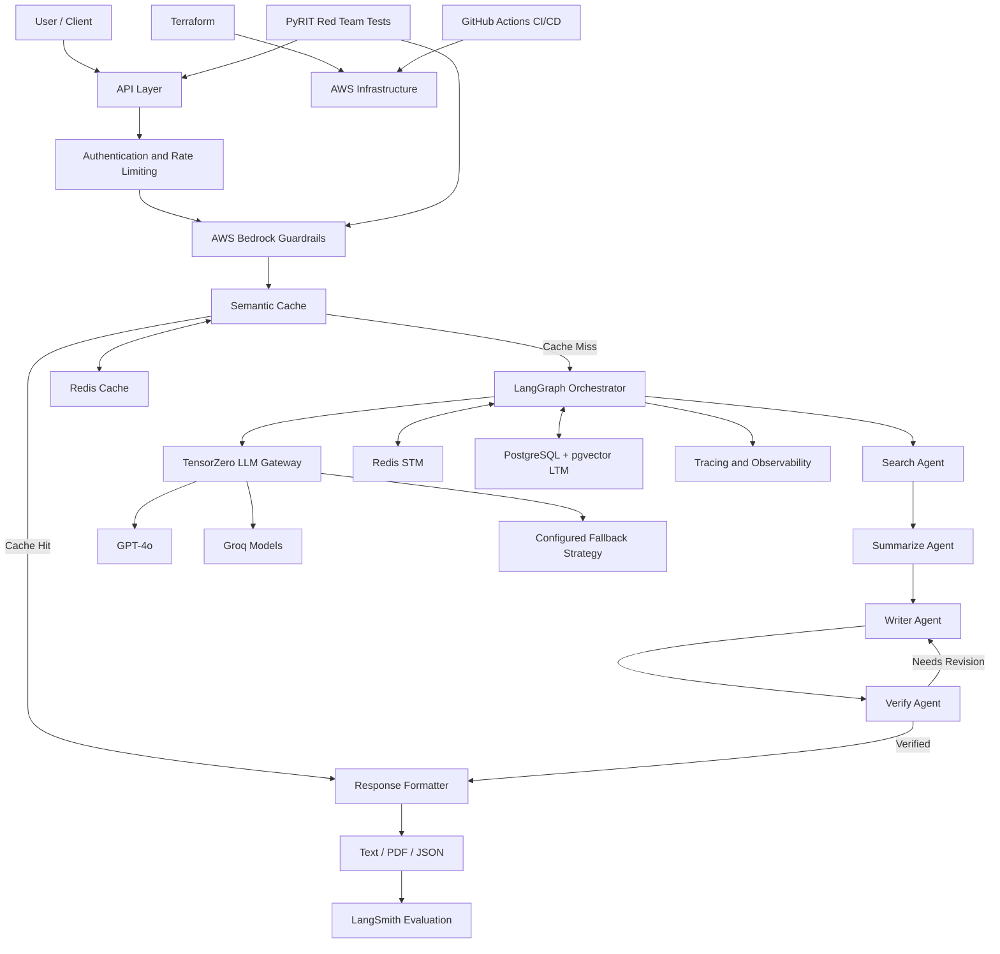
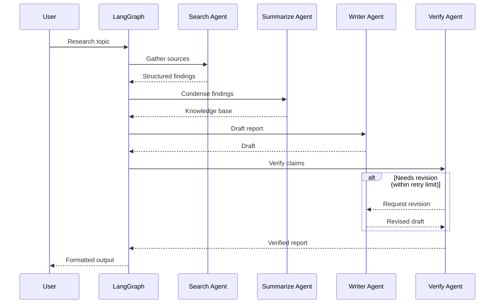
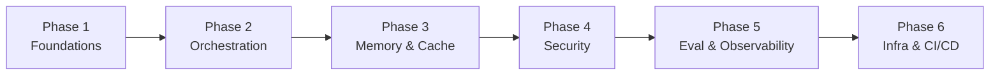

<div align="center">

# 🔎 Queryn

### Multi-Agent AI Research Platform — Project Specification

**An autonomous, secure, and production-oriented AI research platform designed around multi-agent orchestration, enterprise guardrails, long-term memory, and intelligent model routing.**


</div>

---

> **Document status:** This README is a **project specification**. Queryn is in the design phase and has no implementation yet. Everything below describes the **intended** architecture, the **planned** technology stack, and the **proposed** implementation roadmap. Nothing here should be read as a claim that a feature, command, dependency, or configuration value already exists.

---

## Table of Contents

- [Overview](#overview)
- [Goals and Scope](#goals-and-scope)
- [Planned Technology Stack](#planned-technology-stack)
- [Intended Architecture](#intended-architecture)
- [Research Workflow](#research-workflow)
- [Core Components](#core-components)
- [Memory and Caching](#memory-and-caching)
- [Security and Red Teaming](#security-and-red-teaming)
- [Evaluation and Observability](#evaluation-and-observability)
- [Planned AWS Infrastructure](#planned-aws-infrastructure)
- [Proposed Project Structure](#proposed-project-structure)
- [Planned Configuration](#planned-configuration)
- [Deployment Strategy](#deployment-strategy)
- [Testing Strategy](#testing-strategy)
- [Implementation Roadmap](#implementation-roadmap)
- [Design Principles](#design-principles)
- [License](#license)

## Overview

Queryn is a planned AI research system intended to transform a research topic into a structured, verified report through a coordinated multi-agent workflow. The design pairs specialized agents with multi-layered memory, semantic caching, model fallback, automated evaluation, and adversarial security testing.

The target behavior distinguishes Queryn from a basic chatbot: it is designed to **research, synthesize, write, and verify** information through a controlled, observable workflow, with security checks integrated across the request lifecycle.

Because no code exists yet, this document defines **what the system should be** and **how it should be built**, so that implementation can proceed against a clear, agreed specification.

## Goals and Scope

**In scope (planned):**

- A four-agent research pipeline (Search → Summarize → Write → Verify) orchestrated as a stateful graph.
- A centralized LLM gateway with configurable routing and provider fallback.
- Short-term (session) and long-term (semantic) memory, plus semantic caching.
- Input/output guardrails and structured adversarial testing.
- Tracing, LLM-as-judge evaluation, and production-grade AWS deployment via IaC and CI/CD.
- Report export in text/Markdown, PDF, and JSON.

**Out of scope (for the initial specification):**

- Any guarantee of exact service boundaries, retry semantics, or file names — these are finalized during implementation.
- Fixed model choices beyond the planned provider strategy (GPT-4o and Groq-backed models).

## Planned Technology Stack

> Badges and versions above are **targets**, not installed dependencies. Final versions are pinned during implementation.

| Category | Planned Technology |
|---|---|
| Language | Python 3.11+ |
| Agent orchestration | LangGraph |
| LLM gateway | TensorZero |
| Model providers | OpenAI GPT-4o, Groq-backed models |
| AI guardrails | AWS Bedrock Guardrails |
| Short-term memory | Redis |
| Long-term memory | PostgreSQL with pgvector |
| Semantic caching | Redis + embedding-based similarity |
| Tracing and evaluation | LangSmith |
| AI red teaming | PyRIT |
| Cloud platform | AWS |
| Container orchestration | Amazon ECS |
| Container registry | Amazon ECR |
| Database hosting | Amazon RDS |
| Cache hosting | Amazon ElastiCache |
| Networking | Amazon VPC, Application Load Balancer |
| Secrets | AWS Secrets Manager |
| Infrastructure as code | Terraform |
| CI/CD | GitHub Actions |
| Scheduled security testing | Amazon EventBridge |

## Intended Architecture

Queryn is designed as a modular, security-first system that separates request handling, orchestration, model access, memory, evaluation, and infrastructure.



> The diagram is a conceptual target. Actual execution order, retry behavior, guardrail placement, and service boundaries are decided during implementation and should be kept in sync with this document.

### Architecture Layers

| Layer | Intended Responsibility |
|---|---|
| API and access control | Accept research requests; enforce authentication and rate limits. |
| Security | Apply input/output guardrails and validate request scope. |
| Cache | Identify reusable results before running the full workflow. |
| Orchestration | Coordinate the four research agents using LangGraph. |
| Model gateway | Centralize model invocation, routing, and fallback. |
| Memory | Maintain session context and retrieve relevant long-term knowledge. |
| Evaluation | Record traces and evaluate generated reports. |
| Infrastructure | Provide scalable AWS hosting, storage, networking, and deployment automation. |

## Research Workflow

The planned pipeline transforms a user query into a verified report through four specialized agents with a verification loop.



### 1. Search Agent
Gathers relevant information for the topic.
- Interpret the research objective.
- Identify relevant queries and sources.
- Collect source material and supporting evidence.
- Return structured findings for downstream processing.

### 2. Summarize Agent
Condenses collected material into a structured knowledge base.
- Extract key facts and findings.
- Identify relationships between concepts.
- Reduce cross-source redundancy.
- Preserve source references and context.

### 3. Writer Agent
Converts summarized research into a coherent report.
- Organize findings into logical sections.
- Produce readable, well-structured content.
- Incorporate relevant context from memory.
- Generate the requested output format.

### 4. Verify Agent
Reviews the draft before it is returned.
- Assess whether claims are supported by evidence.
- Identify missing context, contradictions, and unsupported statements.
- Check whether the report satisfies the objective.
- Request revisions when necessary, subject to configured retry limits.

The report is returned only after verification and safety checks complete successfully.

## Core Components

### LangGraph Orchestration
The workflow is designed as a stateful graph rather than a set of uncoordinated model calls, supporting:
- Explicit agent transitions and shared workflow state.
- Conditional routing and revision/retry loops.
- Error handling and interruption points.
- Integration with memory and model services.

### TensorZero LLM Gateway
A centralized model-access layer that decouples agents from individual providers:
- Configurable model selection and provider abstraction.
- Centralized inference configuration.
- Model-level observability and performance analysis.
- Fallback routing through a configured provider strategy.

> GPT-4o and Groq-backed models are the planned options. Fallback behavior must be explicitly configured and tested for provider errors, timeouts, rate limits, and unavailable models.

### Research Output Generation

| Format | Use case |
|---|---|
| Text / Markdown | Reading and editing reports. |
| PDF | Sharing and archiving formatted research. |
| JSON | Programmatic consumption and integration. |

## Memory and Caching

Queryn separates conversational memory, persistent knowledge retrieval, and response caching.

### Short-Term Memory (STM) — Redis
Stores session-level information during an active conversation: recent queries, current objectives, conversational context, and intermediate workflow state where appropriate. Session isolation and expiration policies are planned to prevent unrelated conversations from sharing private context.

### Long-Term Memory (LTM) — PostgreSQL + pgvector
Supports semantic retrieval of previously stored research. Intended workflow:

1. Convert eligible research content into embeddings.
2. Store embeddings with associated metadata.
3. Retrieve semantically relevant records for a new request.
4. Supply suitable retrieved context to the workflow.
5. Persist approved information per the configured retention policy.

Access controls, metadata filters, and retention policies are to be defined per data classification.

### Semantic Caching — Redis
Checks whether a prior request is similar enough to reuse an existing result. Intended flow:

1. Obtain a representation of the incoming query.
2. Search for a semantically similar cached request.
3. Apply a similarity threshold and metadata checks.
4. Return a reusable result if safe and sufficiently relevant.
5. Run the full pipeline on a cache miss.
6. Cache eligible results for future requests.

Cache invalidation, similarity thresholds, permissions, and freshness requirements must be configured carefully — similar queries are not automatically interchangeable when scope or required evidence differs.

## Security and Red Teaming

Security is treated as a core architectural concern.

### AWS Bedrock Guardrails
Guardrails are planned to inspect inputs and outputs against configured safety policies, helping address unsafe content, prompt-injection attempts, sensitive-information exposure, untrusted I/O patterns, and out-of-scope requests. Guardrails should be applied at trust boundaries: before untrusted requests enter the workflow, and before responses are delivered.

### API Security
Planned controls:
- Authentication and authorization.
- Rate limiting and request validation.
- Secure secret management.
- Least-privilege AWS IAM policies.
- TLS for network communication.
- Safe error handling and audit logging.

### PyRIT Red Teaming
Structured adversarial testing of the running system.

| Attack category | Testing objective |
|---|---|
| Jailbreak | Determine whether safety restrictions can be bypassed. |
| XPIA | Test whether malicious instructions embedded in external content influence the agent. |
| Crescendo | Test multi-turn escalation that gradually elicits restricted behavior. |
| Skeleton key | Test whether attempts to override safeguards succeed. |

Results should record the scenario, model/guardrail configuration, observed response, and whether the expected security outcome occurred. Scheduled runs are planned via Amazon EventBridge.

> **Security principle:** Guardrails reduce risk but do not guarantee every attack is blocked. Defense in depth, least privilege, adversarial evaluation, and continuous monitoring remain necessary.

## Evaluation and Observability

LangSmith is planned for execution tracing and research-quality evaluation.

### Tracing
Target trace data: agent execution order and duration, model calls and latency, retrieval operations, retry/fallback events, token usage and estimated cost, and workflow/verification outcomes. Sensitive prompts, credentials, and private source material should not be logged unnecessarily.

### LLM-as-Judge Evaluation

| Metric | Purpose |
|---|---|
| Relevance | How well the report addresses the research question. |
| Faithfulness | Whether claims are supported by supplied evidence. |
| Groundedness | Whether statements trace to retrieved source material. |
| Completeness | Coverage of the research objective. |
| Coherence | Organization, consistency, and readability. |

Evaluation should use representative datasets, defined scoring criteria, and human review for important decisions. LLM-as-judge scores are signals, not proof of correctness.

## Planned AWS Infrastructure

| Service | Intended Role |
|---|---|
| Amazon ECS | Run the containerized application and workloads. |
| Amazon ECR | Store versioned container images. |
| Amazon RDS | Host PostgreSQL with the pgvector extension. |
| Amazon ElastiCache | Managed Redis-compatible caching and session storage. |
| Application Load Balancer | Route incoming application traffic. |
| Amazon VPC | Isolate and control network access between services. |
| AWS Secrets Manager | Store credentials and sensitive configuration. |
| AWS Bedrock Guardrails | Apply configured generative-AI safety policies. |
| Amazon EventBridge | Schedule recurring jobs, including red-team runs. |
| Terraform | Provision and manage infrastructure as code. |
| GitHub Actions | Automate build, test, and deployment. |

Production deployment should include health checks, centralized logging, restricted network access, monitoring, and a tested rollback strategy.

## Proposed Project Structure

> A **recommended** layout to guide implementation — not a claim that these files exist.

```text
queryn/
├── app/
│   ├── api/              # routes, auth, middleware
│   ├── agents/           # search, summarize, writer, verify
│   ├── graph/            # workflow, state, routing
│   ├── gateway/          # llm_gateway
│   ├── memory/           # short_term, long_term, semantic_cache
│   ├── security/         # guardrails, scope_validation
│   ├── evaluation/       # evaluators, langsmith
│   ├── red_team/         # pyrit_runner
│   ├── services/         # report_export
│   └── main.py
├── tests/                # unit, integration, security, evaluation
├── terraform/            # main.tf, variables.tf, outputs.tf, modules/
├── .github/workflows/    # deploy.yml
├── scripts/
├── .env.example
├── Dockerfile
├── pyproject.toml
└── README.md
```

## Planned Configuration

> Example variable names. Final names and formats are defined during implementation.

| Variable | Purpose |
|---|---|
| `OPENAI_API_KEY` | OpenAI model access, if configured directly. |
| `GROQ_API_KEY` | Groq model access, if configured directly. |
| `TENSORZERO_BASE_URL` | TensorZero gateway endpoint. |
| `AWS_REGION` | AWS deployment region. |
| `AWS_BEDROCK_GUARDRAIL_ID` | Identifier for the configured Bedrock Guardrail. |
| `AWS_BEDROCK_GUARDRAIL_VERSION` | Guardrail version. |
| `REDIS_URL` | Redis connection URL. |
| `DATABASE_URL` | PostgreSQL connection URL. |
| `LANGCHAIN_TRACING_V2` | Enable LangSmith tracing where supported by the SDK. |
| `LANGCHAIN_API_KEY` | LangSmith API credential. |
| `LANGCHAIN_PROJECT` | LangSmith project name. |

> Never place real credentials in documentation, version control, container images, or unprotected logs. In production, retrieve secrets through AWS Secrets Manager or an equivalent managed mechanism.

## Deployment Strategy

Queryn is planned to use Terraform and GitHub Actions for repeatable cloud deployments. The commands below describe the **intended** workflow; exact commands are confirmed once the implementation exists.

### Infrastructure Provisioning (planned)

```bash
terraform init
terraform validate
terraform plan
```

Apply the plan only after review and in line with your organization's approval process.

### Container Build (planned)

```bash
docker build -t queryn .
```

Tag and push the image to the configured Amazon ECR repository for deployment.

### CI/CD Pipeline (planned)

The GitHub Actions workflow is intended to:

1. Run linting, unit tests, and integration tests.
2. Build and scan the container image.
3. Authenticate to AWS using GitHub OIDC where supported.
4. Push the versioned image to Amazon ECR.
5. Deploy the image to the configured ECS service.
6. Run deployment health checks.
7. Trigger a rollback if health checks fail.
8. Record the deployment outcome.

Use separate environments and scoped IAM permissions for development, staging, and production.

## Testing Strategy

Planned validation areas before any production release.

**Functional**
- Confirm the four-agent workflow runs in the expected order.
- Verify conditional transitions and revision limits.
- Test report generation in all supported formats.
- Confirm retrieval and memory integration.

**Reliability**
- Simulate provider timeouts and rate limits; verify fallback.
- Test database and Redis connection failures.
- Validate cache misses, invalidation, and expiry.
- Test workflow recovery and deployment rollback.

**Security**
- Test prompt injection in user input and retrieved documents.
- Run the PyRIT adversarial suite.
- Verify authentication, authorization, and rate limits.
- Confirm secrets are not exposed in responses or logs.
- Test user/session isolation and guardrail behavior on I/O.

**Quality**
- Evaluate relevance, faithfulness, groundedness, and completeness.
- Compare outputs against a representative benchmark.
- Review failures/regressions through LangSmith traces.
- Combine automated evaluation with human review.

## Implementation Roadmap

A suggested build order. Phases may overlap; each should land with tests before the next begins.



| Phase | Focus | Key deliverables |
|---|---|---|
| 1. Foundations | Project scaffolding | Repo layout, `pyproject.toml`, API skeleton, TensorZero gateway wiring, provider config. |
| 2. Orchestration | Research pipeline | LangGraph graph, four agents, verification/retry loop, output formats. |
| 3. Memory & Cache | State and reuse | Redis STM, PostgreSQL + pgvector LTM, semantic cache with thresholds. |
| 4. Security | Guardrails & red team | Bedrock Guardrails at trust boundaries, API auth/rate limits, PyRIT suite. |
| 5. Eval & Observability | Quality signals | LangSmith tracing, LLM-as-judge rubric, benchmark datasets. |
| 6. Infra & CI/CD | Production readiness | Terraform modules, ECS/ECR/RDS/ElastiCache, GitHub Actions deploy + rollback, scheduled red-team runs. |

## Design Principles

1. **Reason through specialized agents** — break complex research into focused, coordinated tasks.
2. **Ground outputs in evidence** — verify claims against available information.
3. **Secure every trust boundary** — combine managed guardrails with application controls and adversarial testing.
4. **Remember selectively** — use session memory, persistent retrieval, and caching for distinct purposes.
5. **Operate reliably** — instrument the workflow, evaluate results, automate deployments, and test failure scenarios.

## License

No license is defined yet. Add the appropriate license before distributing or deploying the project.

---

<div align="center">

**Queryn — Research intelligently. Verify rigorously. Deploy securely.**

*This document is a specification and will evolve as implementation begins.*

</div>
